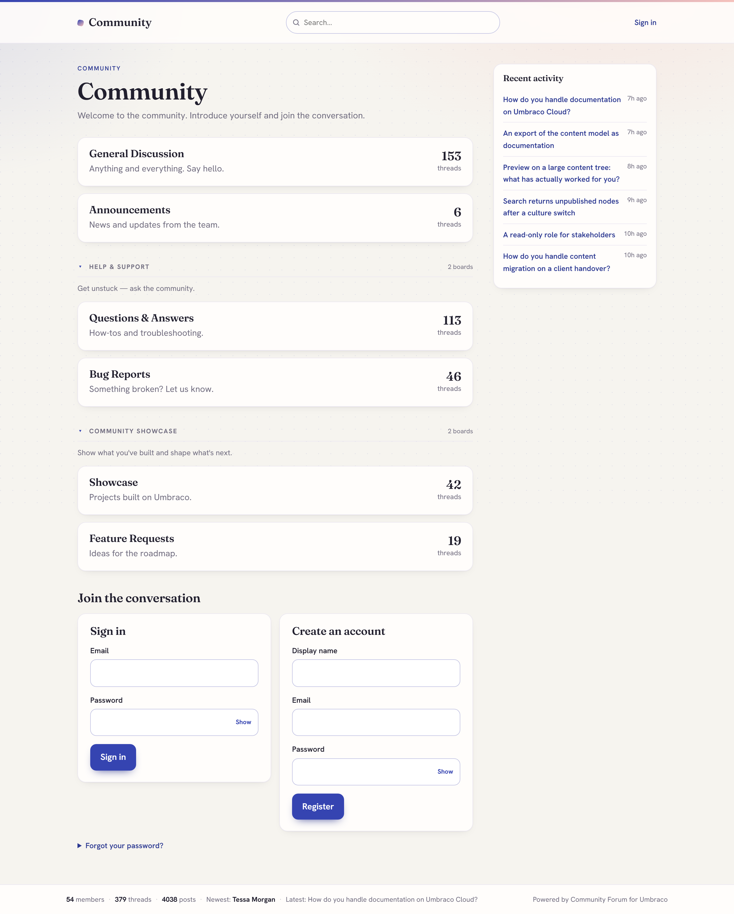
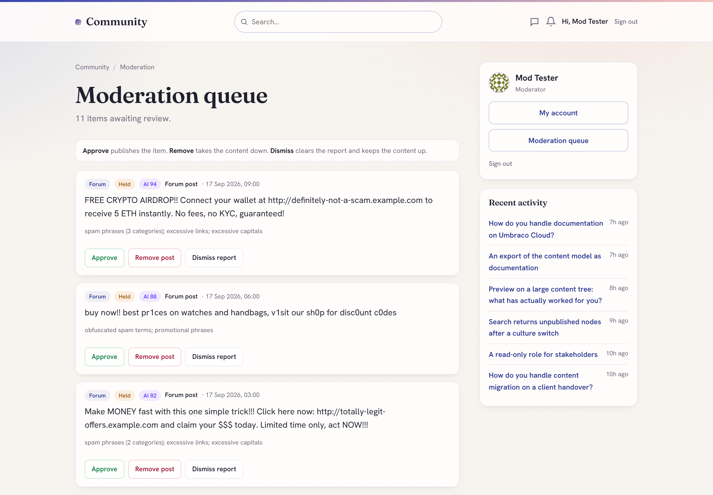
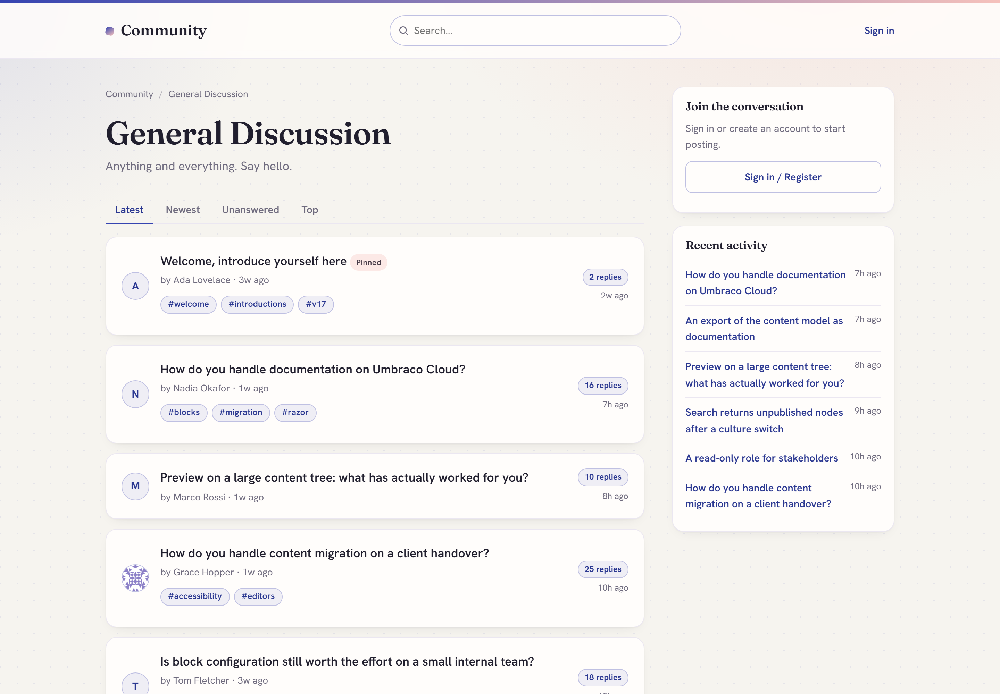
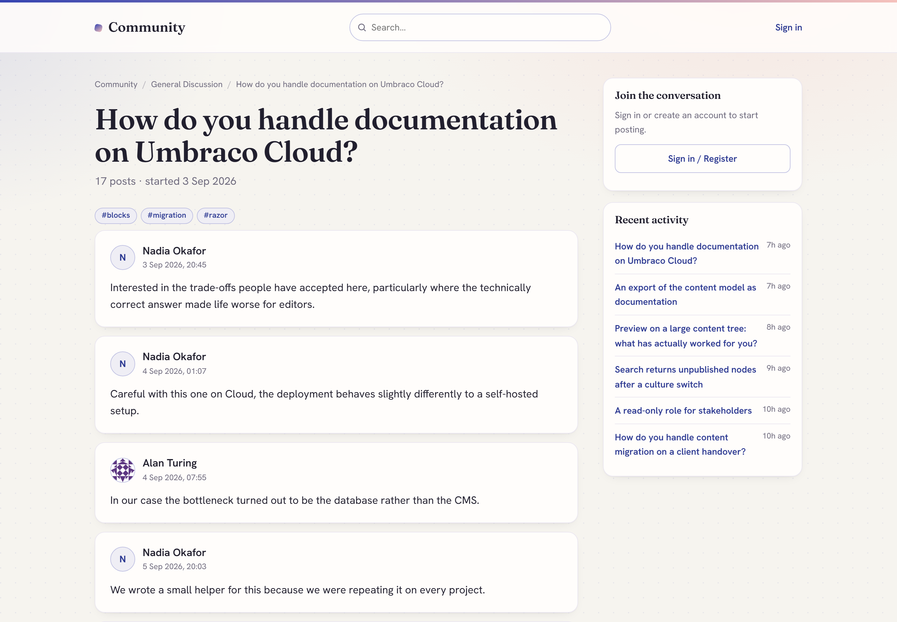
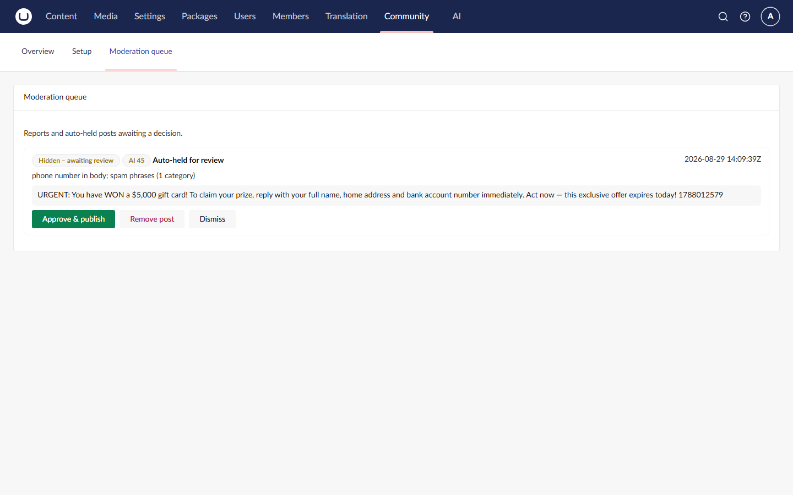

# Community Suite for Umbraco

A discussion forum and page comments for Umbraco 17. Both share one moderation system, one
**Community** section in the backoffice and one moderation queue. Install the forum, the
comments, or both.

This repository holds the documentation, screenshots, changelog and issue tracker. The
packages are installed from NuGet.



## The packages

| Package | NuGet | What it is |
| --- | --- | --- |
| **Community Forum** | [`DigitalWonderlab.CommunityForum`](https://www.nuget.org/packages/DigitalWonderlab.CommunityForum) | A discussion forum that runs inside your Umbraco site. [Docs](docs/community-forum.md) |
| **Community Comments** | [`DigitalWonderlab.CommunityComments`](https://www.nuget.org/packages/DigitalWonderlab.CommunityComments) | Comments for any Umbraco page. [Docs](docs/community-comments.md) |
| **Community AI Moderation** | [`DigitalWonderlab.CommunityAi`](https://www.nuget.org/packages/DigitalWonderlab.CommunityAi) | Optional AI review of posts and comments, through Umbraco.AI. [Docs](docs/community-ai.md) |
| **Community Core** | [`DigitalWonderlab.CommunityCore`](https://www.nuget.org/packages/DigitalWonderlab.CommunityCore) | Shared code. Installed automatically with the forum or comments. [Docs](docs/community-core.md) |

## Moderators don't need backoffice accounts

The people best placed to moderate a community are often volunteers, subject experts or
support staff, and you may not want to give them access to the backoffice.

Add a member to the **Moderators** member group and they can approve and remove posts on the
website itself. Forum posts have a moderation queue at `{forum}/moderation`, and comments
are moderated on the page they belong to. Administrators also have a queue in the
backoffice that shows forum posts and comments together.



## How moderation works

Every post and comment is checked by a rules engine. It scores each one for spam,
profanity, links, contact details and disguised words, and you can add your own blocked
words, spam phrases and promotional phrases and set how strict it is. Anything that scores
too high is held for review or rejected.

On top of that:

- Members can report posts, and enough reports hide a post until a moderator has looked at it
- First posts from new members can be held until they have a short track record
- Moderators can lock, pin and delete threads, and mute or ban members
- Any board or page can be set to hold everything for review
- Every form has a honeypot field and rate limiting

The optional AI add-on asks an AI model to review each post and comment as well. It works
through Umbraco.AI, so you choose the provider. If the AI fails or takes longer than 8
seconds, the rules engine's decision is used.

## How the forum is built

Boards are Umbraco content: you add them in the content tree like any other page, so they
get real URLs, SEO fields, publishing and permissions, and move between environments with
Umbraco Deploy or uSync.

Conversations are not. Threads, posts, comments and member activity are stored in the
packages' own database tables. A busy forum can produce thousands of posts a year, and
keeping them out of the content tree keeps the backoffice usable, keeps members' posts out
of your content deployments, and lets the forum fetch what it needs with ordinary indexed
queries.

Forum users are standard Umbraco Members, so there is no second login to manage.

| A board | A thread |
| --- | --- |
|  |  |

| The backoffice moderation queue |
| --- |
|  |

The full feature lists are in the [forum](docs/community-forum.md) and
[comments](docs/community-comments.md) docs.

## Requirements

**For the forum and comments:**

- Umbraco CMS 17 (17.6.2 or later) on .NET 10
- Umbraco Members
- SMTP, if you want notification emails
- In production, either `Community:Auth:BaseUrl` set to your site's public address or ASP.NET
  Core `AllowedHosts` set to your real host names. Without one of them, password reset and
  verification emails are not sent, because their links would be built from an unchecked
  `Host` header.

**For AI moderation only:**

- [Umbraco.AI](https://marketplace.umbraco.com/package/umbraco.ai), with a connection and
  profile set up. It is free and open source.
- A provider package for the model you want, such as `Umbraco.AI.Anthropic`. Umbraco.AI
  supports Anthropic, OpenAI, Google Gemini, Amazon Bedrock and Microsoft AI Foundry.
- Your own account and API key with that provider. The provider bills you directly; we
  don't. Your key stays in Umbraco.AI and these packages never handle it.

You don't need any of this to moderate. The rules engine is always on and needs no AI.

## Install

```
# the forum, the comments, or both (Core is installed automatically)
dotnet add package DigitalWonderlab.CommunityForum
dotnet add package DigitalWonderlab.CommunityComments

# optional: AI moderation
dotnet add package DigitalWonderlab.CommunityAi
```

Then open the **Community** section in the backoffice and run **Setup**.

## Umbraco Cloud

The packages copy their views and backoffice files into your site when it builds. Umbraco
Cloud sees those files as changes and tries to commit them, which can block deployments.
Before your first Cloud deployment, add the lines for the packages you use to your site's
`cloud.gitignore` (not `.gitignore`):

```gitignore
# Community Core (installed with the forum or comments)
**/App_Plugins/CommunityCore/
**/Views/CommunityAuth/

# Community Forum
**/App_Plugins/Community/
**/Views/forum.cshtml
**/Views/forumBoard.cshtml
**/Views/forumCategory.cshtml
**/Views/_CommunityLayout.cshtml
**/Views/Partials/Community/

# Community Comments
**/Views/Shared/Components/CommunityComments/
**/Views/Partials/blockgrid/Components/communityCommentsBlock.cshtml
**/Views/Partials/blocklist/Components/communityCommentsBlock.cshtml
```

If Cloud has already committed any of these views (you will see an `NETSDK1152` error when
publishing), remove them from your repository with `git rm`.

## Limitations in this version

- The Forum node must sit at the root of the content tree, and one forum per site is supported.
- Comments are not stored per language, so every language version of a page shares one set
  of comments.
- Direct messages are not moderated, and members can't yet block or report a sender.
  Banned and muted members can't send messages.
- Settings are cached on each server, so on a load-balanced site the other servers pick up a
  change when they restart.
- A page's comments and a member's inbox load in full; they are not paged yet.

## Support

- Bugs and feature requests: [open an issue](../../issues).
- Commercial, redistribution or OEM enquiries: [Digital Wonderlab](https://digitalwonderlab.com).

## Licence

Free to use, under a proprietary licence: install it on any number of development, staging
and production sites at no charge. Redistribution and resale are not allowed. The full
licence is included in each package and shown on its NuGet page.

The source code is not published. This repository holds documentation, images and the issue
tracker only.

Built by [Digital Wonderlab](https://digitalwonderlab.com).
