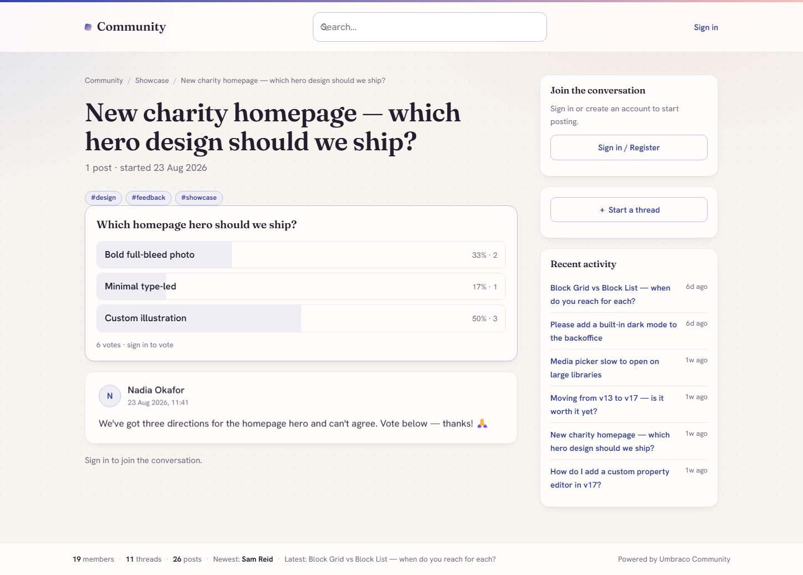
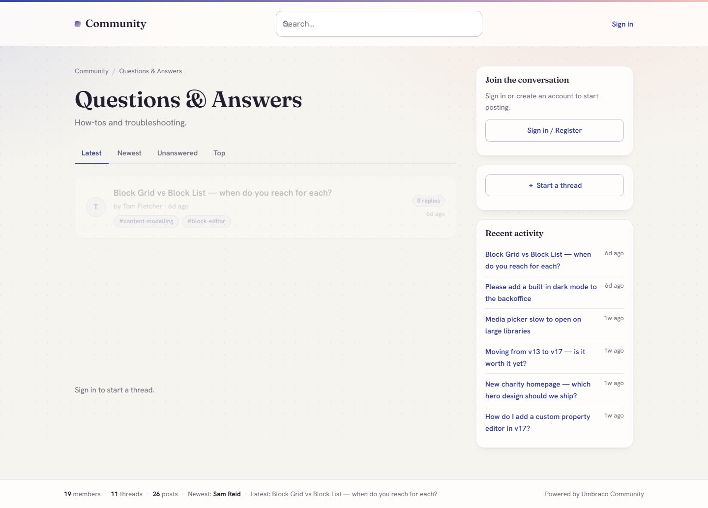

# Community Forum for Umbraco

A discussion forum that runs inside your Umbraco 17 site. Members start threads and reply on
your website, and moderators work either on the website itself or in the backoffice. There is
no separate application to host.

Free to use. See [Licence](#licence).


| Threads and replies | Polls |
| --- | --- |
|  |  |

| Q&A boards | Backoffice moderation queue |
| --- | --- |
|  |  |

## Why we built it

We needed a forum for Umbraco 17 that was rendered on the server, had moderation built in,
and kept members' posts out of the content tree. So we wrote one.

## How it works

Boards are Umbraco content. Conversations are not.

The installer creates four document types: Forum, Forum Category, Forum Board and Forum
Settings. You add and arrange boards in the content tree like any other page, so they get
real URLs, SEO fields, publishing and permissions, and they move between environments with
Umbraco Deploy or uSync.

Threads, posts, profiles, reactions, polls, messages and so on are stored in the package's
own database tables (all prefixed `fm`), which are created when the site starts. This stops
a busy forum filling your content tree with thousands of nodes, keeps members' posts out of
your content deployments, and lets the forum fetch what it needs with ordinary indexed
queries.

Forum users are standard Umbraco Members, so there is no second login to manage.

## Moderators don't need backoffice accounts

The people best placed to moderate a community are often volunteers, subject experts or
support staff, and you may not want to give them access to the backoffice.

Add a member to the **Moderators** member group and they get a moderation queue on the
website, at `{forum}/moderation`, where they can approve, remove and dismiss posts.
Administrators also have a queue in the backoffice, which shows forum posts and page
comments together. Both work on the same data.


Every post is checked by a rules engine that scores it for spam, profanity, links, contact
details and disguised words. You can add your own blocked words, spam phrases and
promotional phrases, and set how strict it is. Posts that score too high are held for
review or rejected. Members can report posts, and enough reports hide a post until a
moderator has looked at it.

If you want an AI model to review posts as well, add the optional
[`DigitalWonderlab.CommunityAi`](https://www.nuget.org/packages/DigitalWonderlab.CommunityAi)
package. The rules engine works without it.

## Features

**Threads and boards**

- Latest, Newest, Unanswered and Top tabs, with pagination on board lists and long threads
- Tags, with a page for each tag
- Polls, with one vote per member and results shown as percentages
- Accepted answers on Q&A boards, with solved threads labelled in listings
- Pinned and locked threads
- Members-only boards, which are left out of search, RSS, the sitemap and all public listings
- Collapsible categories on the forum home page

**Posting**

- An editor with bold, italic, quotes, lists, links, images by URL and emoji
- YouTube and Vimeo embeds
- Reactions, quoting, and editing or deleting your own posts
- Post content is cleaned down to a safe list of HTML tags before it is saved

**Members**

- Register, sign in, reset a password and manage your account
- Members must verify their email address before they can post
- Profiles with display name, signature, post count, avatar and recent threads
- @mentions, direct messages and an in-app notification list
- Optional reply notification emails, sent through your Umbraco SMTP settings
- Unread markers for each member, with "mark all as read"
- Members can delete their own account. Their posts stay, shown as "[deleted user]", and
  their personal data is removed. If Community Comments is installed, their comments are
  treated the same way.

**Moderation**

- A queue on the website for the Moderators group, and one in the backoffice for administrators
- Lock, pin and delete threads, edit or remove posts, and mute or ban members
- First posts from new members can be held until they have a short track record
- Authors can see their own held posts, marked "Pending review". Nobody else can.
- Honeypot fields and rate limiting on every form

**Search and SEO**

- Full-text search using its own Examine index
- Clean URLs, canonical tags, Open Graph and Twitter cards, and `rel=prev/next` on paged lists
- `DiscussionForumPosting` and `QAPage` structured data
- RSS feeds and an XML sitemap
- Pages are rendered on the server and work without JavaScript

**Setup and appearance**

- A Community section in the backoffice with an overview, the moderation queue, settings
  and a setup wizard
- The installer creates the document types, templates, member type and a starter board,
  and is safe to run again
- Set two brand colours to match your site. Dark mode is included.

## Requirements

- Umbraco CMS 17 (17.6.2 or later) on .NET 10
- Umbraco Members
- SMTP, if you want notification emails

## Install

```
dotnet add package DigitalWonderlab.CommunityForum
```

Open the **Community** section in the backoffice and run **Setup**, then add your boards
under **Content**.

## Configuration

Most settings are in the backoffice under **Community > Settings**: brand colours,
notification emails, how strict moderation is, word lists, and the AI switch. The **Forum
Settings** node holds the logo and whether the forum uses your site's own master template.

A few settings go in `appsettings.json`:

```json
{
  "Community": {
    "Auth": {
      "BaseUrl": "https://example.com",
      "ResetPageUrl": "/community"
    }
  }
}
```

- `BaseUrl` is your site's public address. Set it in production, unless ASP.NET Core
  `AllowedHosts` already lists your real host names. Password reset and verification emails
  contain a security token, so they are not sent unless the link can be built from a
  trusted address, and the reason is written to the log.
- `ResetPageUrl` is where the password reset link takes the member. It defaults to
  `/community/sign-in`.

### Reserved addresses

The forum uses `/community/sign-in`, `/community/auth/*`, `/community/feed/*` and
`/community/sitemap.xml`, and these paths under the forum: `account`, `search`, `member`,
`messages`, `notifications`, `tag` and `moderation`. Don't create content pages at those
addresses.

### Umbraco Cloud

The package copies its views and backoffice files into your site when it builds. Umbraco
Cloud sees those files as changes and tries to commit them, which can block deployments.
Before your first Cloud deployment with the package, add these lines to your site's
`cloud.gitignore` (not `.gitignore`):

```gitignore
# Community Core (installed with the forum)
**/App_Plugins/CommunityCore/
**/Views/CommunityAuth/

# Community Forum
**/App_Plugins/Community/
**/Views/forum.cshtml
**/Views/forumBoard.cshtml
**/Views/forumCategory.cshtml
**/Views/_CommunityLayout.cshtml
**/Views/Partials/Community/
```

If Cloud has already committed any of these views (you will see an `NETSDK1152` error when
publishing), remove them from your repository with `git rm`.

## Limitations in this version

- The Forum node must sit at the root of the content tree, and one forum per site is supported.
- Direct messages are not moderated, and members can't yet block or report a sender.
  Banned and muted members can't send messages.
- Settings are cached on each server, so on a load-balanced site the other servers pick up
  a change when they restart.

## Related packages

- [Community Comments](https://www.nuget.org/packages/DigitalWonderlab.CommunityComments):
  comments for any page, moderated from the same queue.
- [Community AI Moderation](https://www.nuget.org/packages/DigitalWonderlab.CommunityAi):
  optional AI review of forum posts and comments.

## Licence

Free to use on any number of sites. Redistribution and resale are not allowed. The full
licence is in the `LICENSE` file in the package.

Built by [Digital Wonderlab](https://digitalwonderlab.com).
